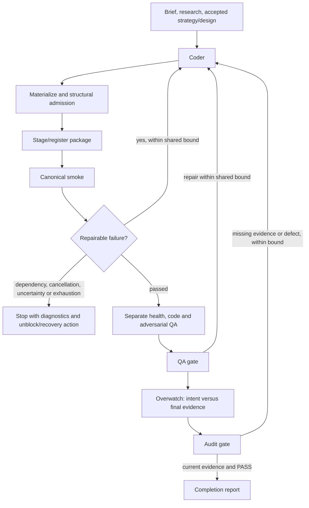
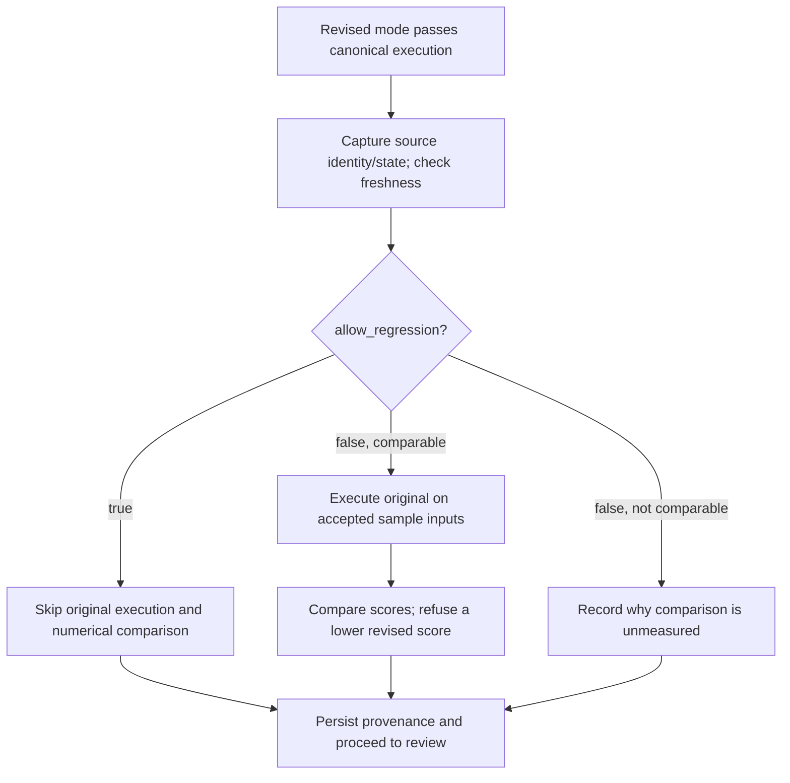

# Authoring validation and intent audits

Create/Edit execute what they built before reviewers sign off. One canonical
runtime operation owns the current revision's smoke, including its generated
score and any model/Task work. Design's declared acceptance command has the same
place in its graph. Listing or registering a package only makes it available for
execution; completion requires successful validation and current review.

Fast Create retains a strategist, coder and one focused QA worker. Fast Edit
retains coder then focused QA. Their smoke now precedes focused QA and shares
`repair_attempts` with structural admission and QA failures. There is no added
Overwatch worker or fan-out. Full Design retains separate health/code/adversarial
reviews and Overwatch after its acceptance command; fast Design retains focused
QA after that command.

## Runtime receipts and repair

`create_ops.gate_smoke` executes `smoke` once for each package attempt. Agent modes
receive a model for that execution; they no longer make a preliminary incomplete
keyless run. `smoke.json` records mode, sample inputs, run directory, status, score
when measured, stdout/stderr, elapsed time and failure information. Distinct smoke
directories preserve the outputs of earlier attempts. `revision.json` separately
records comparison/provenance. Design retains its command and actual output.

`authoring-evidence.json` binds the validation result to hashes of the delivered
source, authoritative brief/strategy/design/plan inputs, applicable ledger entries,
validation settings, receipt files and canonical runtime output files. Each validation receipt also survives in
`.refactory/validation-history/`. Earlier failed or superseded records remain
historical; they cannot certify a repaired revision. This local evidence contract
does not promise exhaustive tracking of external services or every transitive
dependency outside the delivered package.

Repairable implementation/check failures return concrete diagnostics to the
coder. Full modes share an overall attempt cap across admission, runtime and
review failure; within that cap, check failures and review reloops are counted
separately (`check_attempts_used` against `check_attempts`,
`review_attempts_used` against `review_attempts`), so a review reloop does not
consume a check attempt. Fast modes use their existing total repair allowance
but record which kind (`check_repairs_used`, `review_repairs_used`) spent it.
Missing tools/credentials, cancellation, uncertain worker outcomes/timeouts and
resource exhaustion stop with their actual outcome. The artifact and evidence
remain for explicit unblock/recovery; repeating code generation cannot install an
unavailable validation dependency.

The shared resource ledger accounts for work, validation and repair, including
nested model smoke. Review and completion use the validation allocation; a repair
returns to work admission. Token and elapsed caps remain optional and unset by
default. The repair bound controls attempts, not a fabricated token quota.

## What reviewers and Overwatch receive

The common agent-delivery path supplies the latest ledger and captures the
artifact/context identity at dispatch. Health, code and adversarial QA remain
independent full-mode roles. They inspect canonical receipts and delivered output,
then use targeted checks for uncovered requirements. They do not each repeat the
whole model/Task feed.

### Repository questions (design and design_fast only)

For repository-change runs (those with a `target`, `refine`, or `source_project`),
each reviewer must answer three structured questions per changed function:

1. **Duplicates** — where else the repository does the same thing, with `path:line` evidence.
2. **Callers** — who calls it and from which user path, with `path:line` evidence.
3. **Shared state** — what it shares with what already runs (state, files, facts, locks), with `path:line` evidence.

Each answer must include `path:line` evidence, or state `absent: <what was searched>`
when the answer is genuinely "nowhere" or "shares nothing".

The `changed-functions.json` file is computed by the `changed_functions` module, which
maps diff hunk line ranges onto function spans via `ast` (Python) and hunk-range entries
(TypeScript). It is written at `repo_change.py` materialise (unconditional) and
`_check_in_worktree` (conditional). The `changed_functions` fact is rendered into each
reviewer prompt as `{{changed_functions}}`.

The design review also traces the brief's own example through the code in time order,
naming the route a real run takes for every runtime that runs it.

`gate_qa` and the fast `gate_qa` refuse a reviewer output that lacks an entry for a
changed function, or gives an answer with no `path:line` evidence. `gate_design_review`
performs the same check against the design's `[changed]` sites, but at design time a
missing entry is advisory: it is listed at the person's gate and never re-runs the review.

### Marker placement rule

Every reviewer prompt that can report BLOCKING findings carries
`create_ops.MARKER_RULE`, which tells the reviewer to write the blocking
marker only at the start of a finding line in its plain form, never to
wrap it in backticks, a code span or quotation marks, and to put any
example of the format inside a fenced code block, which the parser skips.
This makes it less likely that the `blocking_findings` parser reads an
explanatory mention as a real finding. The parser itself is unchanged, so
a review that ignores the rule can still trip it (tracker dm-220).

### Claim checking

The design review and code_reviewer check each factual claim about existing code at
`file:line`, including uncited premises. A false claim is BLOCKING in the review output.
Cited claims will be checked by a deterministic module (from a parallel run) once it
lands; uncited-claim checking is prompt-only.

### Deliverable-kind conditioning

The `deliverable_kind` fact is computed at prepare time: `"repository_change"` when the
run names a `target`, `refine`, or `source_project`; `"artifact"` otherwise. It uses
`task.get(k) or ctx.knob(k, "")` for each key, so it works on both runtimes.

Repository-change runs get `REPO_CHANGE_REVIEW_INSTRUCTIONS` (code-change review content
composed from verification methods M2, M3, M11, M12, plus repository questions and
claim-checking instructions). Artifact runs get `ARTIFACT_REVIEW_INSTRUCTIONS` (the
rendering and exchange-format text previously inline in health_checker and qa_director).

### Unanswered repository questions

Reviewers answer repository questions (duplicates, callers and shared state, each with
`path:line` evidence or an `absent:` reason) for the run's changed **product** functions
only:

- Test files and generated files are left out. A generated file says so in its first
  lines ("Generated … Do not edit"), as `generated-help.ts` does.
- Code the branch merged in from its base is left out. When a run merges its base after
  it began, a function counts only if it also changed relative to the merged-in commit
  (`changed_functions.merged_upstream`).

Missing repository questions are advisory at every gate, and nothing is re-run for
them: they are the reviewers' bookkeeping, not a defect in the change. A post-build
gate used to re-run every reviewer once when they were its only problem; on a measured
run (dm-149, 2026-10-22) that cost ten minutes and left the same answer missing. The
gate records them in `reviews/qa-gate.txt`, the design review's advisory list, or fast
mode's `fast-report.json`, and the pull request's Verification section lists them. They
never send a build back, re-run a review, or end a run.

Overwatch receives the original brief, accepted strategy/criteria and design,
current applicable ledger, merged reviews and final runtime evidence. It writes
`reviews/overwatch.md` plus `intent-audit.json`. Fast focused QA writes its existing
report plus the same intent map. The map covers every baseline id: `brief`,
`strategy`, explicit `criterion-N` rows when supplied, `design`/`plan`, and current
product-scoped `ledger-N` instructions, including the initial idea.
Process-scoped notes (`--scope process`) are recorded in the evidence payload
under `process_notes` but are not baseline requirements. Compound asks must be decomposed into separate rows even
when they share an id. Each row identifies the requirement, status and supporting
individual file paths with concrete command/output or source findings. Directories,
line-number suffixes and the audit itself cannot serve as evidence references.

For every constraint or correction row, each clause must include a `sites` array:
`"sites": [{"site": "path:line", "tests": ["test_file::test_name"], "scope": "connected"}]`.
Each site names the exact file:line in the diff that builds this clause, the test(s)
that reach it, and the evidence scope (`local`, `connected`, `assembled`,
`artifact`). A multi-clause correction must have sites on each clause, not a single
site on the row. The gate's `correction_audit_problems` checks these sites
mechanically: it verifies the site is in the diff, reverts it and runs the named
test, and enforces the declared scope.

Required behavior without adequate evidence is failed or unverified with a
precise reason. A README limitation or reviewer/coordinator waiver cannot alter
the baseline. An exclusion must cite an explicit user change and quote its exact
text (semantic review must still establish that it really authorizes the exclusion). A missing required
consumer or validation tool stays unverified with its exact unblock action.

The gate requires coverage, substantive evidence references, a final exact PASS
verdict without blockers, and current delivery receipts. A changed artifact,
receipt, validation input or later applicable user instruction invalidates old
sign-off. Completion checks freshness again. Explicit graph redo/recovery still
owns restarting completed nodes and archiving dependent state.

These checks establish traceability and freshness. They cannot mechanically prove
that an agent understood every sentence, that a cited command establishes the
claimed behavior, or that a generated artifact is good. Those remain semantic
review responsibilities, tested with actual modeled acceptance as well as controls.

## Edit comparison policy

The default is still false. With true, no original smoke runs, no delta is
computed and the revision is not classified as regressed/non-regressed.
`before_score` and `regressed` are null; `after_score` describes only the revised
measurement. `revision_note` explicitly says comparison was intentionally skipped.
The source state/digest and provenance remain, and revised correctness/QA still
run. With false, existing comparable/non-comparable behavior and numerical refusal
remain. This is not a new evaluation-editing framework or a performance-improvement
requirement.

CEO uses `--knob allow_regression=true`, the Python/headless Edit command uses
`--allow-regression`, chat's Edit tool uses `allowRegression`, and the panel exposes
the declaration's boolean knob and help. All reach the same `_revision` operation;
historical report fields stay readable.

Implementation: [graphs](../refactory_dsh/create.py),
[fast graphs](../refactory_dsh/fast.py), [operations](../refactory_dsh/create_ops.py),
[evidence contract](../refactory_dsh/authoring_evidence.py),
[delivery](../refactory_dsh/agent_delivery.py),
[controls](../tests/test_authoring_evidence.py).

The [2026-09-27 acceptance record](authoring-validation-acceptance-20260927.md)
separates successful terminal/chat runs, the panel's negative control, incomplete
full-chat attempts, measured usage and deterministic coverage.
